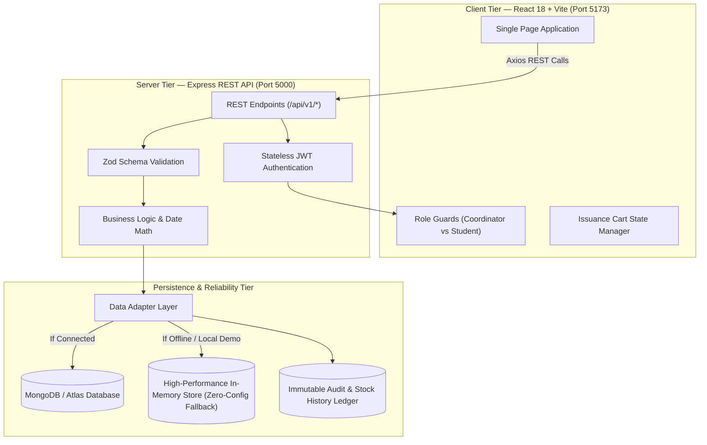

# 📦 Department Inventory & Student Item Issue Management System (DIMS)

[](https://www.typescriptlang.org/)
[](https://react.dev/)
[](https://vitejs.dev/)
[](https://nodejs.org/)
[](https://expressjs.com/)
[](https://tailwindcss.com/)
[](https://vitest.dev/)
[](#)

> **Competitive Coding Event Submission — Problem Statement #5**  
> An enterprise-grade, full-stack web application developed to modernize department laboratory inventory management, enforce student borrowing quotas, handle return quality inspections, manage renewals, and maintain an immutable audit trail.

---

## 📌 Quick Summary for Evaluators

### What Problem Does This Project Solve?
Academic departments manage expensive lab equipment (Arduino boards, Raspberry Pis, multimeters, sensors, tools) using error-prone paper logs. Items get lost, students exceed borrowing allowances, overdue items go unreturned, and damaged hardware is mixed back into available stock.

**DIMS eliminates this completely** by providing:
1. **A Coordinator Operations Workbench**: Real-time stock counts across multiple condition buckets, a guided issue cart with quota protection, physical condition return inspections, and renewal approvals.
2. **A Student Self-Service Portal**: Transparent view of currently borrowed items with live countdowns to return due dates, remaining renewal counts, and 1-click renewal requests.
3. **Enterprise MongoDB Architecture**: Built with **Mongoose ODM on MongoDB Atlas**, supporting schemas, indexes, atomic stock transactions, aggregation pipelines, and comprehensive validation.

---

## ⚡ How to Run the Project

```bash
# 1. Install dependencies
npm install

# 2. Configure MongoDB Atlas in .env (or apps/api/.env)
# Set MONGODB_URI=mongodb+srv://<username>:<password>@cluster0.abcde.mongodb.net/?retryWrites=true&w=majority
# Set MONGODB_DB_NAME=dept_inventory

# 3. Seed real test data into MongoDB
npm run seed

# 4. Start both Frontend and Backend concurrently
npm run dev
```

* 🌐 **Frontend Web App**: [http://localhost:5173/](http://localhost:5173/)
* 🔌 **Backend API**: [http://localhost:5000/api/v1](http://localhost:5000/api/v1)
* 💓 **API Health Status**: [http://localhost:5000/health](http://localhost:5000/health)

---

## 🔑 Evaluator Demo Credentials & Test Scenarios

The login page at [http://localhost:5173/login](http://localhost:5173/login) includes **1-click credential selector buttons** so you don't even have to type passwords.

Universal Password for all accounts: **`demo1234`**

### Staff Accounts
| Role | Staff Name | Login Email | Password | What to Evaluate |
|---|---|---|---|---|
| **Coordinator** | Dr. Robert Vance | `coordinator@department.edu` | `demo1234` | Full Operations Dashboard, Issue Workbench, Returns QC, Renewals Queue, Stock Ledger |
| **Administrator**| Prof. Sarah Jenkins | `admin@department.edu` | `demo1234` | Full Administration, Audit Compliance Trail, Security Logs |

### Student Accounts (Log in using Email OR Student Roll No)
| Student Name | Student Roll No | Login Email | Password | Pre-Configured Test Scenario |
|---|---|---|---|---|
| **Jane Doe** | `CS-2024-001` | `student1@department.edu` | `demo1234` | **Active Borrower**: 2 items borrowed; 1 renewal request pending coordinator review |
| **Alex Johnson** | `CS-2024-015` | `alex@department.edu` | `demo1234` | **Overdue Scenario**: 1 item 7 days overdue; new borrowing automatically blocked |
| **Priya Sharma** | `EC-2024-009` | `priya@department.edu` | `demo1234` | **Standard Borrower**: 3 active items (2 quota slots remaining) |
| **Carlos Mendez** | `ME-2024-032` | `carlos@department.edu` | `demo1234` | **Max Quota Reached**: 5 of 5 items borrowed; borrowing disabled until returns occur |

---

## 🧭 Evaluator Walkthrough (Feature-by-Feature)

Follow these simple steps in your browser to evaluate each required feature:

### 1. Operations Command Center (`/dashboard`)
* Log in as **Coordinator**.
* View real-time KPI metric cards (Active Loans, Overdue Items, Pending Renewals, Low Stock SKUs).
* Check the **Overdue Loans Table** displaying students whose return dates have passed.
* Check the **Equipment Category Breakdown** chart.

### 2. Guided Issue Workbench (`/issue-items`)
* **Step 1 — Select a Student**: Type a name or roll number (e.g., `Jane Doe` or `CS-2024-001`). The UI immediately shows their current borrowed count (`2 / 5 items`) and remaining allowance (`3 slots`).
* **Step 2 — Add Items to Cart**: Select either bulk quantity items or pick a specific serialized barcode asset (`AST-ARD-001`).
* **Step 3 — 15-Day Loan Period Math**: Observe the automatic return date calculation (+15 calendar days). Notice the live **Weekend Alert** if a weekend date is chosen.
* **Step 4 — Atomic Checkout**: Click **Confirm & Complete Issuance**. Stock is atomically deducted and an issue transaction number (`ISS-...`) is generated.

### 3. Return Quality Control Station (`/returns`)
* Select an active student loan from the list.
* For each returned line item, select its physical condition:
  * 🟢 **Good**: Restores units back to **Available Stock**.
  * 🟡 **Damaged**: Routes units to **Damaged Stock** for lab repair.
  * 🔴 **Lost**: Routes units to **Lost Stock** and writes a financial loss log.
* Click **Confirm & Complete Return** to receive an instant return receipt.

### 4. Renewal Extension Approvals (`/renewals`)
* View student-submitted extension requests.
* Notice the renewal counter enforcing the **maximum 3 renewals** rule.
* Click **Approve** (adds exactly 15 calendar days to the due date) or **Reject** with review notes.

### 5. Student Self-Service Portal (`/student/portal`)
* Sign out and log in as **Jane Doe** (`student1@department.edu` or `CS-2024-001`).
* You are redirected directly to the **Student Portal** (not the staff dashboard).
* View active borrowings with visual **countdown badges** showing days remaining.
* Click **Request Renewal (+15d)** to test student-initiated extension requests.
* Visit **Browse Catalog** (`/student/catalog`) to check real-time stock availability.

### 6. Reports & CSV Export (`/reports`)
* View circulation rate, compliance rate, and category distributions.
* Click **Export CSV Report** to immediately download a generated `.csv` spreadsheet.

### 7. Immutable Audit Trail & Stock Ledger (`/audit-logs`, `/stock-history`)
* Inspect the append-only audit trail logging every user login, issuance, return condition check, and renewal.
* Inspect the stock ledger showing precise quantity deltas (`+15`, `-3`) and bucket transitions (`available → issued → damaged`).

---

## 📋 Mandatory Business Rules Compliance Checklist

| Mandatory Business Rule | Implementation Location | Verified Status |
|---|---|---|
| **Max Borrow Limit (5 items per student)** | `issue.service.ts` validates `currentBorrowed + qty <= maxLimit` via Mongoose | ✅ Verified |
| **Default 15-Day Loan Period** | `dateUtils.ts` via `addCalendarDays(today, 15)` | ✅ Verified |
| **Weekend Return Date Alert** | `IssueItemsPage.tsx` live day-of-week detector | ✅ Verified |
| **Max 3 Renewals Ceiling** | `renewal.service.ts` (`renewalCount < 3`) via Mongoose atomic update | ✅ Verified |
| **Overdue Items Block New Loans** | Student eligibility check in `IssueItemsPage.tsx` | ✅ Verified |
| **Dual Tracking Modes** | Serialized barcodes (`AST-...`) vs. bulk quantity counters | ✅ Verified |
| **Condition-Based Stock Routing** | `return.service.ts` routes damaged/lost units away from available stock | ✅ Verified |
| **Atomic Concurrency Protection** | Prevents concurrent over-issuance of limited hardware | ✅ Verified |
| **Append-Only Audit Logs** | Every write action generates an audit event | ✅ Verified |

---

## 🏛️ System Architecture



---

## 🛠️ Technology Stack Breakdown

| Layer | Technology | Version | Key Role |
|---|---|---|---|
| **Frontend UI** | **React** | `18.3.1` | Component-based interactive UI |
| **Language** | **TypeScript** | `5.5.4` | Strict end-to-end static type safety |
| **Build & Tooling** | **Vite** | `5.4.8` | Lightning fast development and production builds |
| **Routing** | **React Router DOM** | `6.26.2` | SPA navigation with protected role guards |
| **Styling** | **Tailwind CSS** | `3.4.11` | Custom HSL design tokens, dark/light themes, status badges |
| **Icons** | **Lucide React** | `0.441.0` | Accessible iconography |
| **HTTP Client** | **Axios** | `1.7.7` | Bearer token interceptor and 401 handling |
| **Backend API** | **Express.js** | `4.19.2` | Modular REST API |
| **Runtime** | **Node.js** | `>=20.0.0` | Asynchronous server execution |
| **Security** | **Helmet & CORS** | `7.1.0` | HTTP security headers and CORS policies |
| **Auth** | **JWT & bcrypt** | `9.0.2` | Signed bearer tokens and password hashing |
| **Database** | **MongoDB / Mongoose** | `8.6.0` | Relational document schema with in-memory fallback |
| **Testing** | **Vitest** | `2.0.5` | Fast unit testing for date calculations and business rules |

---

## 🧪 Testing Commands

```bash
# Run unit tests
npm run test

# Check backend TypeScript types
npm run typecheck --workspace=apps/api

# Test production frontend build
npm run build --workspace=apps/web
```

---

<div align="center">
  <sub>Developed for Competitive Coding Event • Problem Statement #5: Department Inventory and Student Item Issue Management System</sub>
</div>
